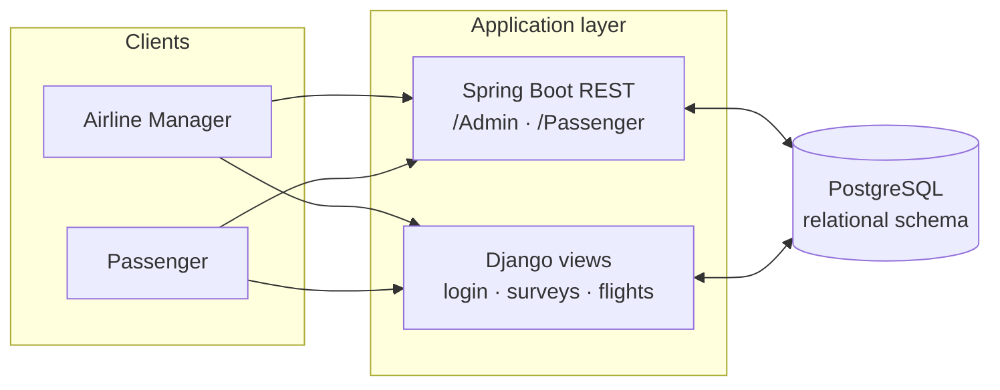
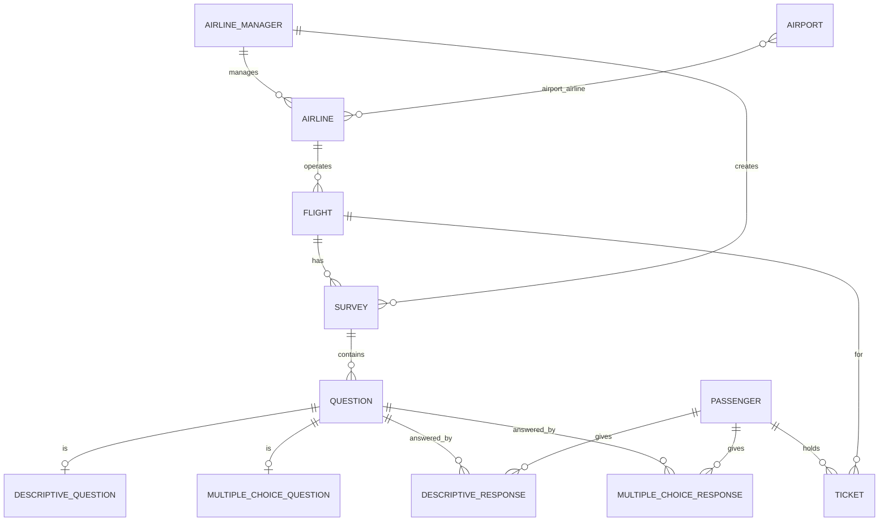

# ✈️ Flight Management System

> A database-centric flight & airline **survey management system**, built for the *Database Design* course and implemented with **two interchangeable backends** (Spring Boot and Django) over a shared **PostgreSQL** schema.

**Team:** Mohammad Aghaei · Mohammad Javad Maheronnaghsh · Mohammad Mahdi Mirzaei
**Course:** Database Design

---

## 📋 Overview

The system lets **airline managers** run satisfaction **surveys** for their flights and lets **passengers** answer them. The heart of the project is a normalized relational schema; the application code is a thin API layer on top of it.

Because the focus is database design, the same domain is implemented **twice** to compare stacks — both talk to the *same* PostgreSQL database:

| Backend | Stack | Role |
|---------|-------|------|
| **`Backend/`** | **Spring Boot** (Java 17) + Spring Data JPA + Lombok | Main REST API (the final version is built with JPA/JDA) |
| **`FlightManagement/`** | **Django** (Python) | Alternative API generated from the existing DB (`inspectdb`, `managed = False`) |

---

## 🗺️ Architecture



Both services map Java entities / Django models directly onto the shared tables, so the **database is the single source of truth** and either backend can serve the same data.

---

## 🧩 Data Model



Core entities: `AirlineManager`, `Airline`, `Airport`, `Flight`, `Passenger`, `Ticket`, `Survey`, `Question` (specialised into **descriptive** and **multiple-choice**), and the corresponding response tables — plus supervisor/manager-review links (`am_am_survey`, `Supervisor`).

---

## 🔌 Key API Endpoints (Spring Boot)

**Admin / airline manager — `/Admin`**

| Method | Path | Purpose |
|--------|------|---------|
| `GET`  | `/get_passenger` | List passengers |
| `POST` | `/add_passenger` · `/update_passenger` · `/delete_passenger` | Manage passengers |
| `GET`  | `/get_survey/{username}` | Surveys owned by a manager |
| `POST` | `/add_survey/{username}` | Create a survey |
| `POST` | `/add_question/{username}` · `/update_question/{username}` · `/delete_question/...` | Manage questions |
| `GET`  | `/get_response_des/{username}` · `/get_response_choice/{username}` | Read survey responses |

**Passenger — `/Passenger`**

| Method | Path | Purpose |
|--------|------|---------|
| `GET` | `/login/{id}/{passId}` | Passenger login |
| `GET` | `/get_active_des/{id}` | Fetch active surveys/questions to answer |

> A ready-to-import **Postman collection** is included at [`Backend/db.postman_collection.json`](./Backend/db.postman_collection.json).
> The Django backend exposes a parallel subset: `login`, `get_questions`, `get_flights`, `get_passengers`, `update_passenger`.

---

## 📂 Repository Structure

```
Flight-Management-System/
├── Backend/                # Spring Boot (Java 17, Maven) REST API
│   ├── src/main/java/com/example/dbproject/
│   │   ├── controller/     # AdminController, PassengerController
│   │   ├── model/          # JPA entities (Flight, Survey, Question, ...)
│   │   └── repository/     # Spring Data JPA repositories
│   ├── db.postman_collection.json
│   └── pom.xml
├── FlightManagement/       # Django app over the same PostgreSQL DB
│   └── survey/             # models.py, views.py, urls.py
└── links                   # reference tutorials used during development
```

---

## 🚀 Getting Started

### Prerequisites
- **PostgreSQL** (create a database and load the schema/tables)
- **Java 17 + Maven** for the Spring Boot backend
- **Python 3 + Django** for the Django backend

### Run the Spring Boot backend
```bash
cd Backend
# configure the DB connection in src/main/resources/application.properties
./mvnw spring-boot:run         # use mvnw.cmd on Windows
```

### Run the Django backend
```bash
cd FlightManagement
pip install django psycopg2-binary
# point settings.py at your PostgreSQL database
python manage.py runserver
```

The models use `managed = False`, so Django maps onto the **existing** tables rather than creating them — make sure the PostgreSQL schema is in place first.

---

## 🛠️ Tech Stack

- **Database:** PostgreSQL (normalized relational design — the project's core)
- **Backend A:** Java 17, Spring Boot, Spring Data JPA, Lombok, Maven
- **Backend B:** Python, Django
- **Tooling:** GitHub Projects for task management, Postman for API testing
